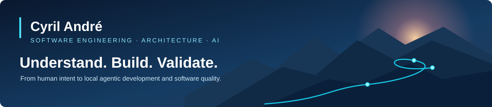

  

<strong>Software Architect · Engineering Lead · AI-assisted Software Engineering</strong> 
Brussels, Belgium · Founder of <a href="https://lilarisz.be">Lilarisz</a>

## About me

I'm a hands-on software architect and engineering leader with around **30 years of experience** designing, building, modernizing, and delivering software. My work spans business discovery, architecture, engineering leadership, and hands-on development.

**Software engineering is about solving problems, not producing lines of code.**

I'm exploring how AI changes software engineering beyond code generation: understanding intent, coordinating implementation, validating outcomes, and keeping humans accountable.

## What I'm building & exploring

### Korvany — From human intent to actionable requirements

An exploration of **AI-assisted requirements engineering**: turning ambiguous ideas into structured, validated requirements through conversation, knowledge modeling, and explicit human decisions.

*Can AI help us understand what should be built before we start building it?*

### Local Agentic Development — An autonomous development team on a Mac

An experimental **local-first** development environment with open-weight models on Apple Silicon and **no automatic cloud fallback**.

The working foundation includes LM Studio + MLX, OpenCode, Spec Kit, LiteLLM and Langfuse, with a reversible installer. A local Kanban board is the first implementation pilot.

A LangGraph-based multi-agent orchestrator, short-lived session coordination, loop detection, and explicit cloud approval are **planned, not yet implemented**.

*How far can autonomous software development go with local models while keeping human checkpoints?*

### CRAP4CSharp & CRAP IDE — Making code quality visible

[CRAP4CSharp](https://github.com/Cyril-Andre/crap4csharp) is my fork of Microsoft's C# CRAP metric tool. It combines cyclomatic complexity and test coverage and adds machine-readable JSON/SARIF output.

[CRAP IDE](https://github.com/Cyril-Andre/crapide) explores making those insights available inside development environments, beginning with VS Code/Cursor.

*Can we make code quality easier to observe and act on during everyday development?*

## Engineering principles

- **Understand before implementing.** A technically correct solution to the wrong problem is still a failure.
- **Keep architecture pragmatic.** Architecture should enable change.
- **Use AI without delegating responsibility.** Human judgment remains essential.
- **Prefer evidence over assumptions.** Testing, observability, and measurable quality matter.
- **Experiment, measure, learn.** Understanding limitations matters as much as demonstrating capabilities.

## Technologies & practices

**Languages:** C#, Dart, TypeScript, SQL  
**Backend:** .NET, ASP.NET Core, REST APIs, Entity Framework  
**Cloud & infrastructure:** Azure, Docker, CI/CD, distributed systems  
**Frontend:** Flutter, React, Angular  
**AI engineering:** Local LLMs, MLX, LM Studio, OpenCode, Spec Kit, LiteLLM  
**Practices:** Software architecture, DDD, Clean Architecture, testing, technical leadership

## Writing & perspectives

I write about software architecture, engineering practices, and the evolving role of software engineers in the age of AI.

[Read more on Lilarisz](https://lilarisz.be)

---

*The tools keep changing. The responsibility to build the right software remains.*
